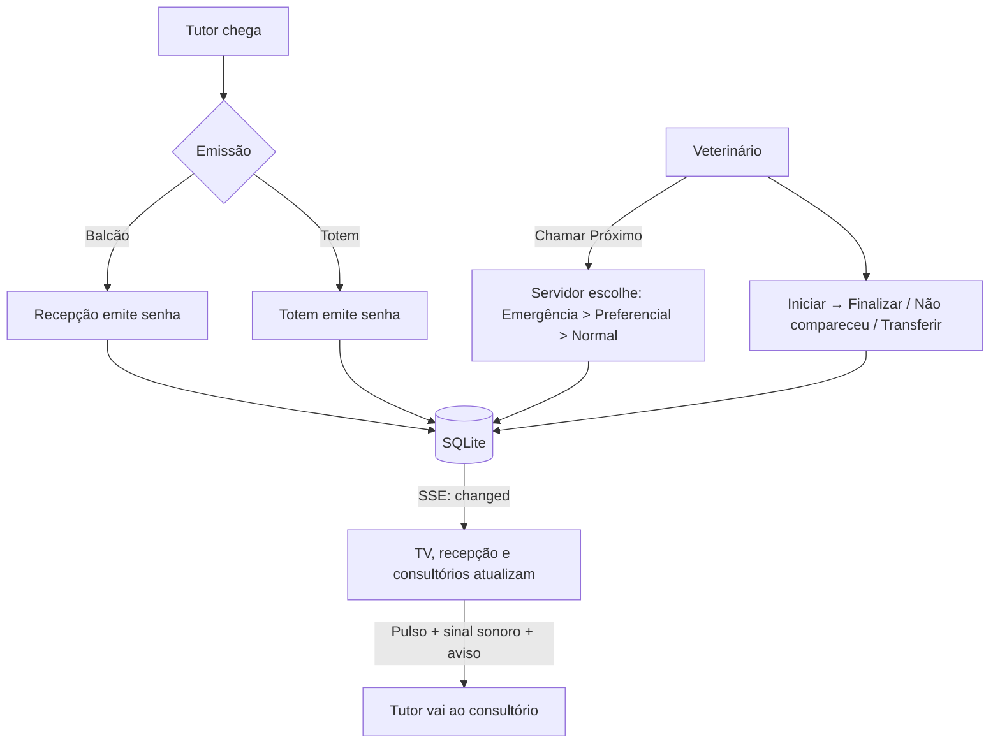

# Arquitetura e telas

## Visão geral

```
 Navegadores (TV, recepção, consultórios, totem)
        │  HTTP + SSE (rede local)
        ▼
 Servidor Node (server/)  ── Express: API REST, /api/events (SSE), uploads, arquivos estáticos
        │
        ▼
 SQLite  data/fila.db   +   data/uploads/ (logotipo, vídeos)   +   data/backups/
```

- **Frontend**: React 18 + Vite + Tailwind (`web/`), compilado para `web/dist` e servido pelo próprio servidor Node. Fontes e ícones embutidos: funciona sem internet.
- **Backend**: `server/app.js` (rotas), `server/queue.js` (regras da fila), `server/db.js` (SQLite + migrações), `server/config.js` (ajustes), `server/media.js` (uploads), `server/backup.js`.
- **Compartilhado**: `shared/cores.js` gera a escala da cor da marca no servidor e na tela de Ajustes.
- **Um processo, uma porta** (3000). Docker opcional.

## Telas

| Rota | Tela | Quem usa | Função |
| :--- | :--- | :--- | :--- |
| `/` | Recepção & Triagem | Recepcionistas | Emitir senhas, prioridade, quadro de status, chamar, transferir, imprimir cupom. |
| `/tv` | Telão | TV da sala de espera | Senha gigante, nome/sala, som, privacidade, últimas chamadas e próximos, **vídeos MP4**. |
| `/chamar` · `/chamar/<salaId>` | Chamador | Veterinários | Chamar próximo, repetir, iniciar, finalizar, ausente, retornar, transferir. |
| `/totem` | Totem | Tutores (tablet touch) | Escolher serviço, informar nome/pet, imprimir senha. |
| `/metricas` | Métricas | Gestão | TME, TMA, volume por serviço, ausência. Hoje / 7 / 30 dias. |
| `/config` | Ajustes | Gestão | Cor, logotipo, vídeos, salas, serviços, cupom, backup. PIN opcional. |

Barra de navegação flutuante em todas as telas, exceto `/tv` e `/totem` (modo quiosque).

## Fluxo operacional



## Telão (`/tv`) em detalhe
- **Fundo escuro** de alto contraste; senha em fonte monoespaçada de até ~14rem.
- **Nova chamada**: pulso visual, sinal sonoro (2 tons, Ré5 + Lá5, sintetizado via Web Audio, sem MP3) e, no layout de tela cheia, aviso grande por alguns segundos. Ao abrir a TV, a chamada já existente **não** toca de novo (só memoriza).
- **Preferências por aparelho** (som e privacidade) ficam no `localStorage` da TV e sobrepõem o padrão definido em Ajustes.
- **Privacidade (LGPD)**: só a senha, sem nome do tutor/pet.
- **Tela cheia**: botão no topo (a maioria dos navegadores de TV exige o gesto do usuário).
- Políticas de autoplay: o primeiro clique/toque libera o áudio.

## Regras que as telas assumem
Veja `banco-sqlite-e-api.md` (ordem de chamada, ações, transferência, numeração diária).

## Resiliência
SSE para atualização imediata + consulta a cada 10 s + reconexão automática. Se o servidor cair, as telas mostram a faixa vermelha "Sem conexão com o servidor da clínica" e se recuperam sozinhas quando ele volta. Em quedas de energia, o SQLite (WAL) mantém os dados íntegros.
